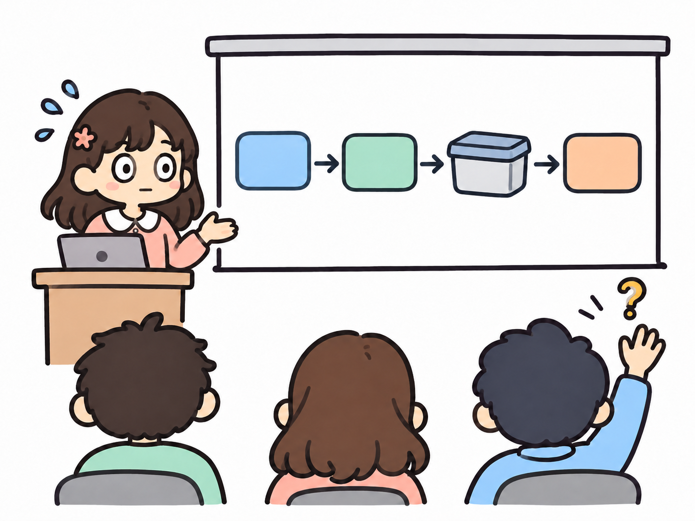

## 1. 대답하지 못한 질문

문서 생성 AI 에이전트 PoC를 팀에 공유하던 날이었다. 내가 만든 파이프라인을 설명하고 질문을 받는데, 아주 간단한 질문 하나에 말문이 막혔다.

"Code Interpreter 비용은 뭘 기준으로 산정되나요? 응답에서 그걸 알 수 있는 값이 있나요?"

Code Interpreter는 컨테이너 안에서 코드를 실행하고, 비용은 컨테이너의 메모리 등급과 사용 시간으로 매겨진다. 컨테이너 객체에는 `memory_limit`, `created_at`, `last_active_at` 같은 값이 있다. 답은 거기 있었다.

직접 짠 코드였다면 디버거로 응답 객체를 한 번은 열어봤을 거다. 그런데 이 코드는 내가 짠 게 아니었다. 스펙과 플랜을 리뷰하고, AI가 한 번에 생성한 결과를 받았을 뿐이다. 그래서 그걸 고려해야 한다는 생각조차 못 했다.

내 이름으로 올라간 코드를, 나는 설명하지 못했다.

이 글은 그날 이후 AI 개발 워크플로우를 어떻게 바꿨는지에 대한 기록이다. 나는 지난 1년여 동안 AI 애플리케이션 개발을 새로 맡으며 프론트엔드에서 백엔드까지 영역이 넓어졌다. 그 사이 작업 방식이 몇 번 뒤집혔고, 지금은 **Living Spec**이라고 부르는 방식에 정착해 있다. 격변하는 시기라 이것도 금방 바뀌겠지만, 지금 시점의 스냅샷으로 남겨둔다.

- spec-driven으로 빠르게 만들던 시절과 그 대가
- 느린 원인을 다시 정의한 과정
- Living Spec의 구성과 작업을 자르는 기준
- 다시 그 문서 생성 기능 이야기

## 2. 빨라진 줄 알았다

처음 정착한 방식은 흔히 말하는 spec-driven이었다. superpowers 플러그인으로 스펙을 쓰고, 스펙 기반 플랜을 만들고, 둘 다 꼼꼼히 리뷰한다. 그다음 상위 이슈와 하위 이슈로 나눠 각각 별도 worktree에서 AI에게 맡기고, merge 직전에 최종 리뷰를 한다.

생성은 정말 빨랐다. 많은 날은 GitLab MR이 하루 10개까지 올라왔다. 문제는 리뷰였다.

MR 본문부터 손봤다. 처음엔 상세하게 쓰게 했다. 결과물은 방대했고, 한 줄짜리 변경과 핵심 로직 변경이 같은 무게로 나열됐다. 사실만 적혀 있었지만 읽히지 않았다.

그래서 구조를 줬다. Summary, How it works(그림으로), Affected Pages, Details, Decisions(스펙 밖에서 내린 결정과 선택지의 트레이드오프), Review Points, Risk. 이 틀에 맞춰 요약시켰다.

리뷰가 빨라졌을까? 아니었다. 코드를 직접 열면 본문에 없는 사양이 계속 나왔다. 게다가 AI가 쓴 본문은 읽다가 화가 치밀 정도로 장황했다(이 문제는 한동안 따로 붙잡고 있었다).

결국 AI가 만든 코드를 리뷰하고 책임 분리, 디자인 패턴, 함수명, 컨벤션을 바로잡아 다시 수정하는 시간이, 사양과 암묵지를 다 알고 직접 개발했을 때와 **똑같이** 걸렸다. 생성에서 번 시간을 리뷰에서 그대로 돌려준 셈이다.

더 큰 문제는 그다음이었다.

> 어제 내가 뭘 시켰더라? 이번 주에 뭘 했더라?

기억나지 않았다. 코드에는 내가 검토하지 않은 사양이 숨어 있었고, 그게 쌓였다. 나는 이걸 **이해의 부채**라고 부른다.

마침 맡고 있던 기능이 그 부채를 가만두지 않았다. 보안 문서 협업 플랫폼 랩소디의 문서 생성 AI 에이전트다. 이 기능은 백엔드 서버, Java 오케스트레이션 서버, Python 서버를 모두 거친다. 처음엔 초안 하나만 만드는 단일턴에, 기존 AI 기능처럼 폴링 방식이었다. 개발이 진행되면서 SSE가 붙었고, 멀티턴이 붙었다.

이해의 부채가 쌓인 상태에서 사양이 추가되면 무엇이 영향을 받는지 알 수 없다. 결국 과거의 작업을 하나씩 다시 리뷰했다. 생성에 든 시간만큼.

## 3. 병목은 리뷰 이전에 있었다

나는 개발자다. 내가 만든 작업물을 책임지려면 다 알아야 한다. 그래서 질문을 바꿨다. 리뷰를 건너뛰는 법이 아니라, 리뷰를 빠르게 하는 법.

MR 본문을 아무리 다듬어도 소용없었던 이유를 거슬러 올라가니 세 가지가 남았다.

1. **스펙을 충분히 검수하지 않았다.** 생성 전에 걸렀어야 할 빈칸이 코드에서 발견됐다.
2. **이해하기 어려운 양으로 쪼갰다.** 한 번에 머리에 넣을 수 없는 MR은 아무리 요약해도 결국 다 읽어야 한다.
3. **스펙과 그 이해가 변경되지 않았다.** 한 번 확정한 스펙은 사양이 바뀌어도 그대로였고, 바뀐 사실은 코드에만 남았다.

병목은 리뷰를 돕는 문서가 아니라 리뷰 이전 단계에 있었다.

예전에 나는 잘 변경되는 코드를 만들려고 애썼다. 지금은 **잘 변경되는 스펙**을 만들려고 한다.

## 4. Living Spec: 변경이 쉬운 작업 계획

그래서 만든 게 Living Spec이다. 한 문장으로 하면 **변경이 쉬운 작업 계획**이다.

| | spec-driven (이전) | Living Spec (현재) |
|---|---|---|
| 스펙의 역할 | 생성 전에 한 번 확정하는 입력 | 작업 내내 갱신하는 기준본 |
| 리뷰 시점 | 스펙·플랜 전체 리뷰 후, merge 때 코드 리뷰 | 스펙을 반복 비판하고, Task마다 코드 전수 리뷰 |
| 생성 단위 | 이슈 단위로 한 번에 | 단일 커밋으로 묶이는 Task 하나씩 |
| 사양이 바뀌면 | 코드에만 반영 | 스펙의 결정·Task·검증을 함께 갱신 |
| 병렬성 | worktree 병렬 | 공통 계약이 있으면 순차 |

Living Spec에는 네 가지를 담는다.

- 지원할 기능 목록
- 그 기능을 호출하는 **액터**와, 액터가 할 수 있는 **유즈케이스**
- 유즈케이스 구현에 필요한 결정 중 **작업 공수가 크게 갈리는 것**
- 비슷한 책임끼리 묶은 **Task**

별도 Plan 문서는 없다. Task까지 스펙 안에 있다. 이 워크플로우는 Claude Code와 Codex에서 함께 쓰도록 [agent-orchestration](https://github.com/Yeonny0723/agent-orchestration) 플러그인으로 정리해 두었고, 공개용 [샘플 스펙](https://github.com/Yeonny0723/agent-orchestration/blob/master/examples/spec/document-generation/spec.md)도 있다. 아래 예시는 그 샘플(가상의 독서 모임 활동 요약 PDF 내보내기)에서 가져왔다.

### 4-1. 우리의 언어는 바뀌지 않았다

AI가 쓴 글이 읽히지 않는 문제를 붙잡고 있다가 도착한 답은 의외로 오래된 것이었다. 그림이다.

스펙의 중심은 draw.io로 그린 유즈케이스 다이어그램, 시퀀스 다이어그램, 클래스 다이어그램, 플로우차트다. 그림을 먼저 보고 코드를 리뷰하면 훨씬 빨리 읽힌다. 글로는 그림으로 표현할 수 없는 정책만 남긴다.

UML을 쓰면서 하나 재해석한 게 있다. 유즈케이스 다이어그램의 **액터**다. 교과서에서 액터는 보통 사람이지만, 코드에서는 호출자가 명확하다. 백엔드라면 앞단의 프록시 서버나 클라이언트가 액터고, 프론트엔드 공통 컴포넌트라면 그걸 가져다 쓸 다른 개발자나 호출부가 액터다. 이렇게 보면 어느 영역에서든 "누가 이걸 어떻게 부르는가"로 유즈케이스를 쓸 수 있다.

AI와 일하는 방식은 바뀌었지만, 설계를 주고받는 언어는 바뀌지 않았다. 유즈케이스, 시퀀스, 클래스. 수십 년 전부터 쓰던 그 언어가 AI의 장황한 문장보다 훨씬 정확했다.

### 4-2. 얼마나 디테일해야 하나

스펙 하나를 만들 때 얼마나 디테일해야 할까. 유즈케이스까지? 인프라까지? 인터페이스까지? 한동안 이게 가장 큰 고민이었다.

지금 기준은 이렇다. **공수가 크게 갈리는 결정**과 **운영에서 뒤늦게 터질 것**을 앞당겨 찾는 데까지다.

- 사용자 인터페이스에서 일어날 수 있는 모든 유즈케이스. `/grill`로 빈칸을 찌른다.
- 기능 목표, 데이터를 저장하고 전달하는 방식과 형태, 인터페이스 같은 큰 결정
- 여러 프로젝트가 엮일 때의 비용과 책임 소유권
- 예외 흐름
  - 운영에서 뒤늦게 발견되기 쉬운 문제
  - 정책적으로 뺄 사양인지 여부
  - FeatureFlag 같은 동작 정책
  - LLM·문서 처리의 timeout, 재시도 횟수, 토큰 한도 같은 운영 기준

샘플에서는 이런 예외 흐름이 정책 표로 남는다.

| 정책·상황 | 저장 상태·이력 | 재시도·정리·담당 |
|---|---|---|
| P04 버튼 중복·접수 응답 유실 | 같은 draft_id·request_key는 작업 1개 | 응답 유실 재전송에는 기존 키 사용 |
| P05 변환 timeout·Worker 중단 | 45초 초과는 failed, 5분 넘은 running도 failed 처리 | 늦은 완료는 failed를 덮어쓰지 않음 |

디테일만큼 중요한 게 반대 방향이다. **사양을 점진적으로 좁히고 복잡도를 덜어내는 것.** 샘플의 "고정 서식 하나만 제공한다"는 결정은 여러 서식 제안을 줄여 첫 출시 범위를 단순화한 결과다. 이 과정을 더 비판할 게 없을 때까지 반복한다.

### 4-3. 결정에 상태를 붙인다

그래도 좁혀지지 않는 결정은 반드시 남는다. 그래서 결정마다 상태를 붙인다.

| 상태 | 의미 | 다루는 방식 |
|---|---|---|
| 확정 | 정해진 결정 | 그대로 개발한다 |
| 잠정 결정 | 협업자와 정해야 하지만 아직 못 정했다 | 바뀔 수 있다는 전제로 진행한다 |
| 검토 중 | 내가 모르는 부분이라 다른 팀의 답을 기다린다 | 병목으로 인지하고, 목업으로 우회한다 |
| 후순위 | 지금 보여줄 결과물보다 뒤에 둔다 | 제외 범위에 기록한다 |

이렇게 나눈 이유는 **결정마다 바뀌는 이유가 다르기 때문**이다. 확정은 내가 다시 열지 않는 한 그대로다. 잠정은 협업자의 답이 오면 바뀐다. 검토 중은 외부 응답이 와야 풀린다. 후순위는 보고 일정이 바뀌면 올라온다. 바뀌는 이유가 다르니 다르게 다뤄야 한다.

| 항목 | 결정 상태 | 현재 결론 |
|---|---|---|
| D05 파일 수명 | 잠정 결정 | 성공 후 48시간 다운로드 허용. 사용성 확인 후 재검토 |
| D06 PDF 변환 | 검토 중 | 공급자 확인 전까지 내부 계약은 목업으로 진행 |
| D08 이메일 공유 | 후순위 | 다운로드까지 먼저 제공 |

이 표시가 없을 때 나는 이랬다. 외부 답을 기다리느라 일정은 밀리는데, 무엇 때문에 밀리는지 설명하지 못했다. 개발은 하는데 보여줄 결과물은 없는 사람이 됐다.

### 4-4. 무엇이 스펙을 살아 있게 하나

스펙을 갱신하게 만드는 건 두 가지였다.

**첫째, 보고 주기.** 3주짜리 일이라도 3주 뒤에 처음 결과를 보여줄 수는 없다. 1주차, 2주차마다 눈에 보이는 진척이 필요하다. 회사 구성원으로서의 책임이기도 하지만, 중간 결과는 방향을 일찍 바꿀 기회이기도 하다.

실제로 Python 쪽을 개발하고 Java 중개 서버와 SSE 로직을 붙이려던 참에, "한번 테스트해 보자, GUI 툴부터 달라"는 요청이 먼저 들어왔다. GUI 툴을 내놓고 SSE를 개발하는 사이에는, 그 툴로 테스트하다 나온 큰 문서 QA 건이 다시 우선순위를 가져갔다. 그때마다 스펙의 Task 순서와 상태를 고쳤다.

**둘째, 외부 의존.** 혼자 하는 작업은 계획대로 진행하면 된다. 다른 팀과 맞물린 작업은 상대의 속도를 내가 통제할 수 없다. 그런 Task는 다시 쪼갠다. 기다려야 하는 부분과, 그 사이 내가 목업으로 먼저 진행할 수 있는 부분으로. 샘플에서 PDF 변환기 계약이 검토 중인 동안 T03a(고정 PDF 목업)와 T03b(실제 변환기 연결)를 나눈 게 그 형태다.

## 5. 리뷰 가능한 단위로 자르기

Task 크기의 기준은 **단일 커밋**이다. 이 변경이 하나의 feat, fix, chore 안에 들어가는가. 하나로 묶이지 않으면 쪼갠다. 커밋이 여러 개 쌓인 MR은 사실상 리뷰할 수 없다고 본다.

Task 하나를 끝내면 코드를 전부 리뷰하고 태클을 건다. 승인된 범위의 코드, 테스트, 스펙 갱신을 같은 커밋에 넣고, 그 커밋 전에는 다음 Task로 넘어가지 않는다.

순서는 두 가지 원칙으로 정한다.

- **공통 계약을 먼저 한다.** 완전히 격리된 작업이면 다른 세션에서 병렬로 돌린다. 하지만 랩소디처럼 서버 세 개가 계약을 공유하면 대부분 순차다.
- **눈에 보여야 하는 것부터 PoC 수준으로 만든다.** 문서 생성 기능이라면 이런 순서다.
  1. 문서 다운로드와 미리보기
  2. SSE
  3. 호출 실패 복구, 재시작 후 회차 상태 복원
  4. 생성 중 취소, 서버 중복 요청 방어

윗분들은 되는지 안 되는지를 빨리 보고 싶어 하고, 그 결과는 영업 포인트로도 먼저 쓰인다. 운영 안정성은 그다음에 붙여도 늦지 않다. 그래서 스펙에도 지금 할 수 있는 것과 아직 못 하는 것을 구분해 쓴다.

## 6. 개발 분야가 바뀌어도 통하는 작업 흐름

프론트엔드에서 백엔드로 넘어오면서 리뷰할 때 보는 것이 꽤 달라졌다.

| | 프론트엔드 | 백엔드 (AI 기능) |
|---|---|---|
| 핵심 질문 | 상태가 제대로 전이되는가 | 오래 운영해도 버티는가 |
| 검증 | 상태 관리 테스트, 재현이 어려운 시나리오(다중 사용자 실시간 등)는 E2E, UI는 직접 실행해 캡처 첨부 | 반환 데이터 정합성, 트랜잭션 |
| 구조 | 도메인·비즈니스·UI 로직의 레이어 분리, 공통 영역과 확장 영역 구분 | 기존 컨벤션과 하위 호환 |
| 운영 | | 비용과 레이트 리밋, 커넥션 풀, 로그, 컨텍스트 생명주기 |

프론트엔드는 백엔드에서 오는 데이터를 받아 그리는 쪽이라 상태 복잡도가 핵심이었다. 백엔드는 지금 돌아가는 것만으로는 부족했다. 사용량이 늘어도, 오래 켜 둬도 문제가 없는지를 봐야 했다.

그런데 체크리스트가 바뀌어도 흐름은 그대로였다. 스펙에서 빈칸을 찾고, 리뷰 가능한 크기로 자르고, 하나씩 전부 읽는다. 영역마다 달라지는 건 grill에서 찌르는 질문과 리뷰에서 보는 항목뿐이다.

## 7. 대답해야 할 순간이 다시 왔을 때

문서 생성 기능 이야기로 돌아가자. PoC로 방향을 정하고 개발하던 중, 큰 문서로 엣지 케이스를 테스트하다가 토큰 초과가 터졌다. 템플릿 문서, 수정된 문서, 누적된 수정 스펙이 그대로 컨텍스트에 들어가고 있었다.

예전 방식이었다면 이 변경이 어디까지 번지는지부터 막막했을 거다. 이번엔 그 작업을 책임지던 과거의 Task로 바로 돌아가 컨텍스트 병목을 찾았다. 그리고 OpenAI Responses API와 Code Interpreter(컨테이너 기반 문서 편집)를 다시 PoC해 파이프라인을 재구성했다.

돌아보면 문서가 영향 범위를 알려준 건 아니었다. 스펙에서 토큰 초과가 일어날 수 있는 파이프라인 구간을 이미 구분해 뒀고, 무엇보다 내가 스펙과 코드와 그 사이의 암묵지를 다 알고 있었다. 그래서 해당 구간으로 바로 들어갈 수 있었다.

Living Spec의 진짜 산출물은 문서가 아니었다. **내가 다 이해하고 있는 상태**다. 발표에서 대답하지 못했던 그날의 나에게 없던 게 바로 그것이었다.

## 8. 얻은 것과 남은 것

재작업이 줄었다. spec-driven으로 개발한 뒤 되돌리고 수정 커밋을 올리느라 늘어난 커밋이 200여 개였다. Living Spec으로 진행한 작업에서는 40~50개 정도다. 같은 작업을 두 방식으로 나눠 해본 게 아니라서 정확한 비교는 아니다.

수치보다 큰 변화는 두 가지다. 큰 그림을 그리게 됐다. 그리고 사양, 구조, 코드를 빠짐없이 설명할 수 있게 됐다.

대가도 있다. 스펙 쓰는 시간이 훨씬 길어졌고, 병렬 실행은 거의 포기했다. 다만 완료까지 걸리는 전체 시간이 늘지는 않았다. 앞에서 더 쓰는 시간을 뒤의 재작업에서 덜 쓴다.

여전히 남은 문제도 있다. Task 단계에서도 부채는 생긴다. 컨벤션이나 디자인 패턴이 어긋나고, 로깅이 빠지고, 불필요한 파일이 생기고, 검증이 과하다. 프로젝트별 컨벤션 지침이 있지만 불완전해서 리뷰 때마다 같은 지적을 반복한다. 프로젝트별 리뷰 체크리스트를 파이프라인에 넣는 게 다음 숙제다.

## 9. 맺으며

요즘 AI가 쓴 PR 본문을 읽다 보면 이상한 피로가 쌓인다. 변경된 코드와 내 질문 이력을 다 보고도, AI는 무엇이 중요한지 구분해서 쓰지 못한다. 그러니 읽는 나도 대충 읽게 되고, 읽고 또 읽게 된다. 그러다 책 원문을 펼쳤는데 너무 잘 읽혀서 놀랐다. 독해력이 떨어진 게 아니라, 중요도가 매겨진 글을 오랜만에 읽은 거였다.

스펙도 마찬가지다. 무엇이 확정이고 무엇이 아직 흔들리는지, 무엇을 먼저 보여줄지를 사람이 매겨 둬야 AI가 만든 결과물을 끝까지 읽을 수 있다.

지금까지의 결론은 당연한 얘기다. 빨리, 잘 하려면 부지런해야 하고, 잘 덜어내야 하지만, 더 넓게 봐야 한다.

AI가 코드를 대신 써 줘도, 이해는 대신 해주지 않는다.

지금까지가 내 작업 파이프라인이다. 읽는 분들도 같은 고민을 하셨는지, 혹은 다른 방법으로 풀어 오셨는지 궁금하다. 이 글이 조금이라도 도움이 되었으면 좋겠다. 이만 글을 마친다.
